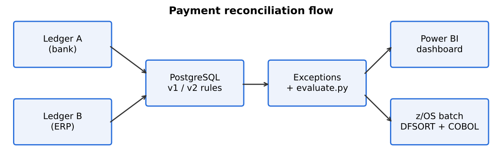
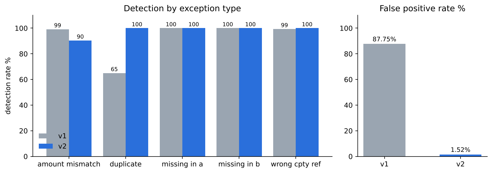
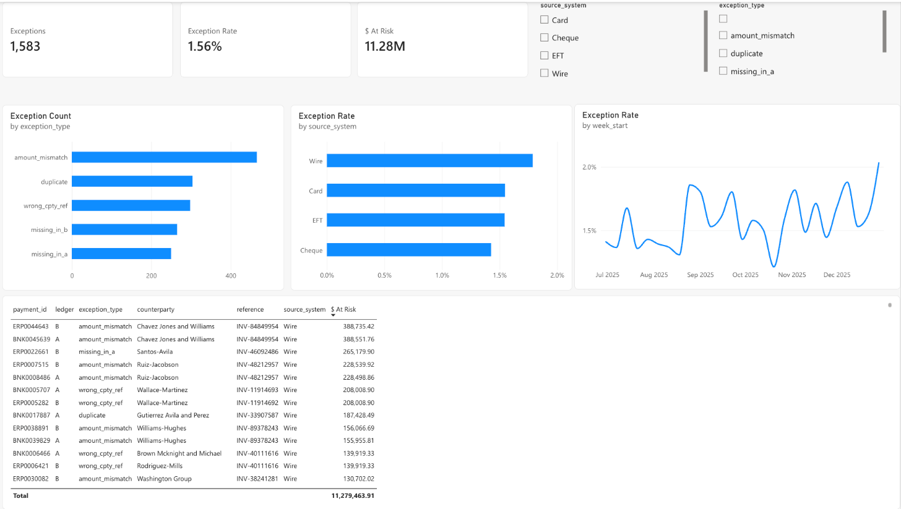

# Payment Reconciliation & Exception Analytics

A pipeline that matches 50,000 payments between a bank ledger and an ERP ledger, flags the ones that don't line up, and checks itself against a known answer key.

<i>Two ledgers go into PostgreSQL, the rules flag exceptions, results feed a Power BI dashboard and a mainframe batch job.</i>

## Results

| | v1 (simple rules) | v2 (refined rules) |
|---|---|---|
| Planted exceptions caught (of 1,200) | 91.0% | 98.0% |
| False positive rate | 87.8% | 1.5% |
| COBOL output = SQL output | | yes, 0 of 101,231 records differ |
| IBM Z batch run (Z Xplore) | | all 101,231 records in about 3 s, RC=0000 |

The miss analysis traced v1's problems to split payments and rounding. v2 fixed both. Details in [results.md](results.md).

<i>Detection by exception type and false positive rate, v1 vs v2.</i>

<i>The Power BI report: exception rate by type, source system and week, with the biggest open exceptions first.</i>

## How it works

1. `generate.py` makes both ledgers with realistic noise (late posting, FX rounding, split payments) and plants exactly 1,200 problems such as duplicates, missing records and amount mismatches.
2. SQL rules in PostgreSQL match the two sides. v2 adds a cent tolerance, a proper split rule and a duplicate check.
3. `evaluate.py` scores each version against the answer key, and a miss analysis query groups every miss by cause.
4. The v2 rules also run as a COBOL/JCL batch job on IBM Z (sort, then one pass over both files), tested on IBM Z Xplore.

## How to run

1. `pip install -r requirements.txt` and `docker compose up -d` (PostgreSQL 16)
2. `./run_all.sh` runs everything: data, both rule versions, scoring, COBOL check, charts
3. Check `results/` and [results.md](results.md)
4. IBM Z: `bash scripts/run_zos.sh` with Zowe CLI, details in [docs/runbook.md](docs/runbook.md)
5. Power BI: steps in [powerbi/README.md](powerbi/README.md)

## What I learned

- Most v1 "exceptions" were normal noise. Grouping the misses by cause showed exactly which two rules to fix.
- A tolerance cuts both ways: the 2 cent window that absorbs FX rounding also hides real 1 cent errors.
- A one-pass COBOL job only works if both files are sorted on the key it groups by.

Docs: [requirements](docs/requirements.md) · [runbook](docs/runbook.md) · [record layouts](mainframe/LAYOUT.md)
