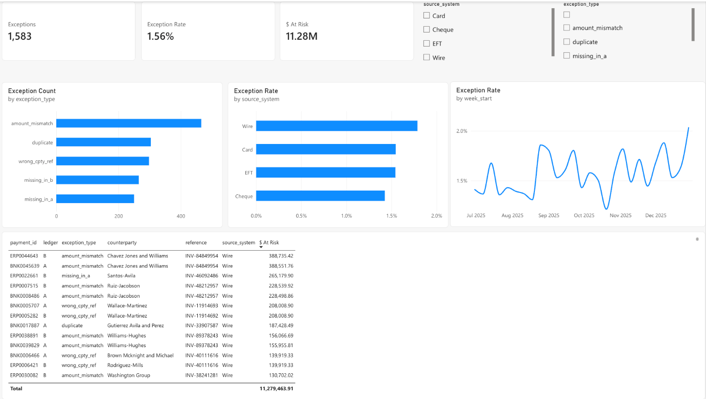

# Power BI dashboard

Built in the Power BI service (app.powerbi.com, works on Mac) from `v_recon_bi.csv`. Report name: **Payment Reconciliation Dashboard**, semantic model `recon_model`.

`v_recon_bi.csv` comes from the view `v_recon_bi` in `sql/05_powerbi_views.sql`. Exceptions are one row each, matched records are rolled up by ledger + source + week with a `record_count`, so the file is 180 KB instead of 12 MB and every rate still adds up (101,231 records, 1,583 exceptions).

## Rebuild it

1. Export the file: `psql -h localhost -U postgres -d recon -c "\copy (select * from v_recon_bi) to 'powerbi/v_recon_bi.csv' csv header"`
2. app.powerbi.com > Create > CSV > Upload file > Next > Create a report, name the model `recon_model`
3. Open semantic model > switch to Editing > New measure, add each measure from `measures.dax`. Set Exception Rate to percentage, 2 decimals
4. New report from the model, one page:
   - cards: Exceptions, Exception Rate, $ At Risk
   - slicers: source_system, exception_type
   - bar: exception_type x Exception Count
   - bar: source_system x Exception Rate
   - line: week_start (not the date hierarchy) x Exception Rate
   - table: payment_id, ledger, exception_type, counterparty, reference, source_system, $ At Risk, sorted by $ At Risk desc. The measure hides the rolled up matched rows
5. Save as Payment Reconciliation Dashboard

With Power BI Desktop (Windows) you can instead connect straight to PostgreSQL (`localhost:5432`, database `recon`) and load `v_recon_bi`, same measures.

Note: `$ At Risk` converts USD at the rate in the `fx_rate` table (1.37 is a placeholder, update it).

The saved report is `recon_dashboard.pbix` (downloaded from the service, opens in Power BI Desktop).
